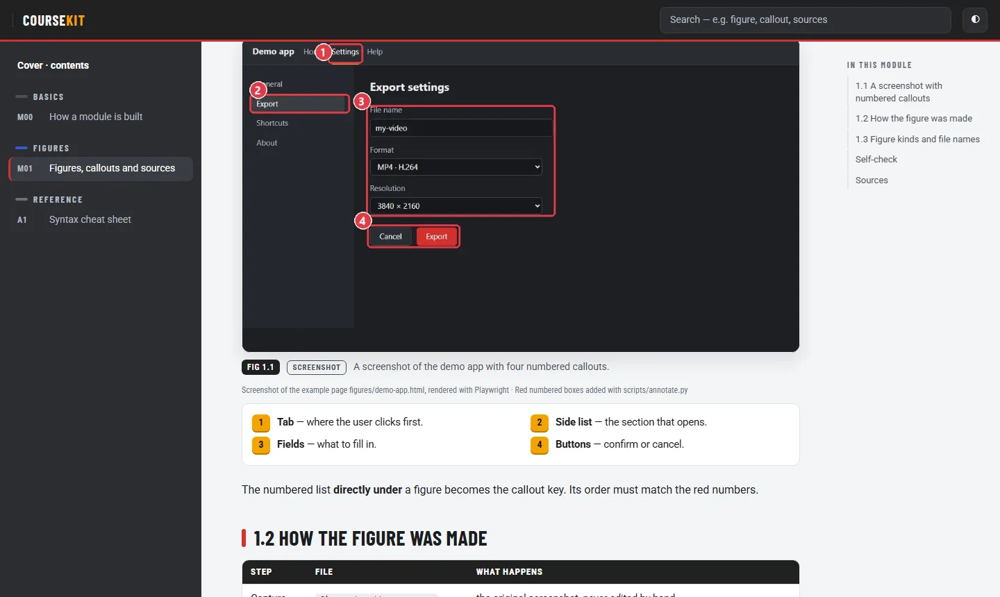
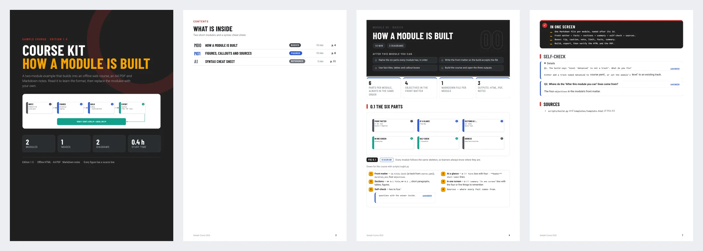
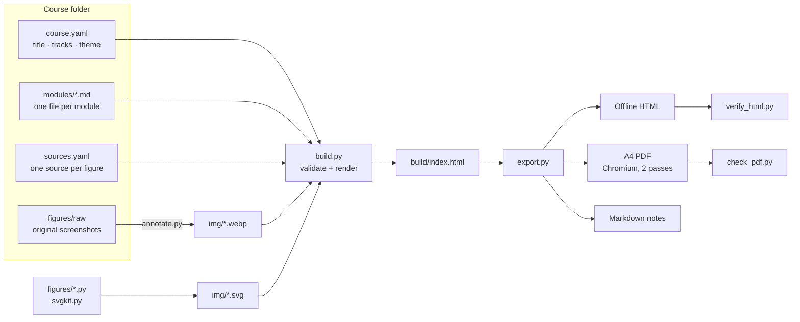

<p align="center"></p>

<p align="center">
  <a href="https://github.com/Khalidfpv/syllabind/actions/workflows/ci.yml"></a>
  <a href="https://github.com/Khalidfpv/syllabind/releases/latest"></a>
  <a href="LICENSE"></a>
  
  
</p>

# Syllabind

*Syllabus + bind: binds your Markdown lessons into one finished, checked course.*

**Write a course once in Markdown, then ship it three ways:** a searchable offline web course, a print-ready A4 PDF with a
real contents page, and Markdown notes. Includes annotated screenshots, diagrams, self-check questions and a cited
source under every figure.

It ships as an **Agent Skill**, inside a **Claude Code plugin**. The skill teaches the assistant the whole method:
scope, research, figures, writing rules and verification. The scripts do the building and checking.





## What you get

| Output | Features |
|---|---|
| **Offline HTML** | cover, contents, side rail, search, figure lightbox, light / dark, "mark complete" progress, mobile layout, zero network requests |
| **A4 PDF** | full-bleed cover, contents page with page numbers (two-pass print), one module per chapter, page footer |
| **Markdown notes** | one note per module with callouts and figure source lines (Obsidian-friendly) |
| **Checks** | build validation, an offline HTML test in headless Chromium, and a PDF layout / overflow test |

## Install

### As a plugin (recommended, keeps you updated)
In Claude Code:
```
/plugin marketplace add Khalidfpv/syllabind
/plugin install syllabind@syllabind
```
Then ask: *"Build a course about … with screenshots"*, or invoke `/syllabind:syllabind`.

### As a standalone skill
- **Claude Code:** copy `skills/syllabind/` to `~/.claude/skills/syllabind/`.
- **claude.ai:** download `syllabind-<version>.zip` from the [Releases](https://github.com/Khalidfpv/syllabind/releases)
  page (or run `python tools/package_skill.py`), then upload it in **Settings › Capabilities › Skills**.

### Python dependencies (once per machine)
```bash
pip install -r skills/syllabind/scripts/requirements.txt
python -m playwright install chromium
```
Python 3.10+, on Windows, macOS or Linux. When you use the plugin, the assistant runs these two commands for you
the first time (from the installed skill folder).

### Update or remove
From a terminal (restart Claude Code after an update):
```bash
claude plugin marketplace update syllabind
claude plugin update syllabind@syllabind
claude plugin uninstall syllabind@syllabind
```

## Quick start (without the assistant)

From the repository root (the new course is created next to the repository, not inside it):
```bash
python skills/syllabind/scripts/new_course.py ../my-course --title "My Course 2026" --with-example-content
python skills/syllabind/scripts/build.py ../my-course
python skills/syllabind/scripts/export.py ../my-course --dest ../my-course/out
python skills/syllabind/scripts/verify_html.py ../my-course/out
python skills/syllabind/scripts/check_pdf.py "../my-course/out/My Course 2026.pdf" --course ../my-course
```
Open `../my-course/out/My Course 2026.html`. Leave out `--with-example-content` to start from two empty modules.

## How it works



## Repository map

| Path | What it is |
|---|---|
| [`.claude-plugin/`](.claude-plugin/) | plugin manifest (`plugin.json`) and marketplace catalogue (`marketplace.json`) |
| [`skills/syllabind/SKILL.md`](skills/syllabind/SKILL.md) | the skill: workflow, rules, file map |
| [`skills/syllabind/reference/`](skills/syllabind/reference/) | authoring, figures, config and verification rules |
| [`skills/syllabind/scripts/`](skills/syllabind/scripts/) | build, export, annotate, diagrams, checks |
| [`skills/syllabind/templates/`](skills/syllabind/templates/) | web page design and print stylesheet |
| [`skills/syllabind/example/`](skills/syllabind/example/) | complete sample course (2 modules + appendix) |
| [`skills/syllabind/assets/fonts/`](skills/syllabind/assets/fonts/) | bundled fonts (SIL OFL 1.1) |
| [`tools/`](tools/) | maintainer tools (skill zip packaging) |
| [`docs/`](docs/) | documentation index and images |
| [`.github/`](.github/) | CI (builds, exports and checks the example on Windows, macOS and Linux), issue and PR templates |

## How to test

Run the same checks the CI runs, from the repository root:
```bash
python skills/syllabind/scripts/build.py skills/syllabind/example
python skills/syllabind/scripts/export.py skills/syllabind/example --dest out
python skills/syllabind/scripts/verify_html.py out
python skills/syllabind/scripts/check_pdf.py "out/Sample Course 2026.pdf" --course skills/syllabind/example
claude plugin validate . --strict
```
All of them must print `PASS` (or `Validation passed`).

## Documentation

See [`docs/README.md`](docs/README.md) for the full documentation map. Start with the sample course, which
documents the format itself.

## Contributing and licence

Contributions are welcome: see [CONTRIBUTING.md](CONTRIBUTING.md), the [Code of Conduct](CODE_OF_CONDUCT.md) and the [security policy](SECURITY.md). Code is under the [MIT licence](LICENSE).
The bundled fonts are under the [SIL Open Font License 1.1](skills/syllabind/assets/fonts/OFL.txt).
