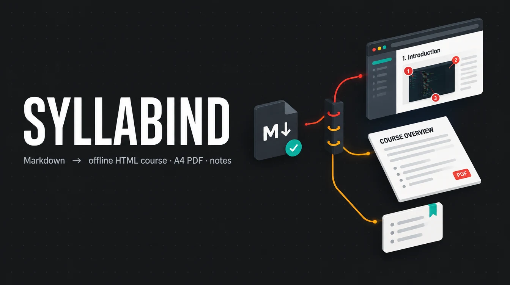
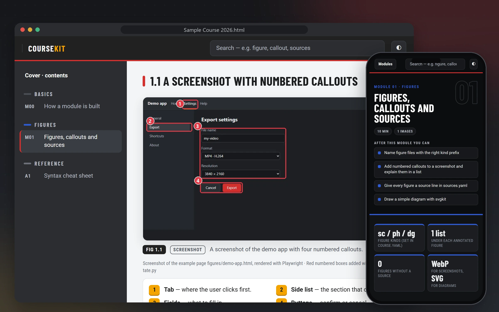
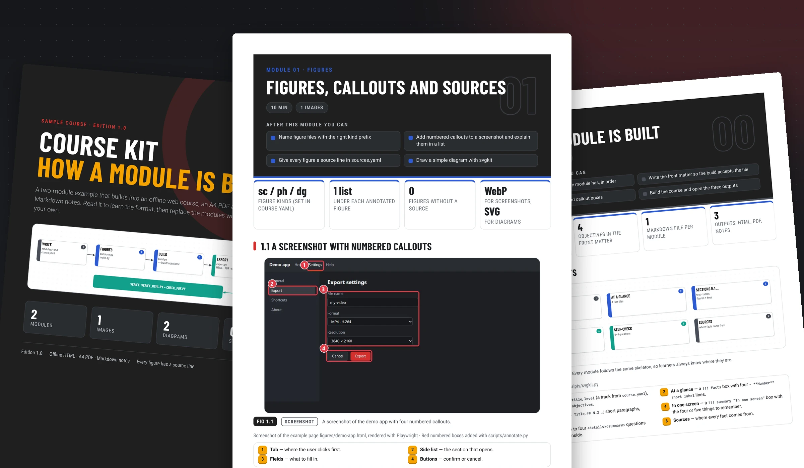
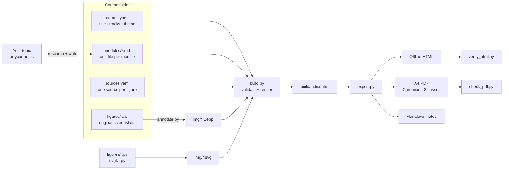

<p align="center"></p>

<p align="center">
  <a href="https://github.com/Khalidfpv/syllabind/actions/workflows/ci.yml"></a>
  <a href="https://github.com/Khalidfpv/syllabind/releases/latest"></a>
  <a href="LICENSE"></a>
  
  
</p>

# Syllabind

*Syllabus + bind: give it a topic, get a finished, checked course.*

**Give it a topic, get a complete course.** The assistant researches the subject and writes the lessons as Markdown
modules, with annotated screenshots, diagrams, self-check questions and a cited source under every figure. Syllabind then
builds the same lessons into several versions: a searchable offline web course, a print-ready A4 PDF with a real
contents page, and Markdown notes. You can also bring your own notes and turn them into a course.

Syllabind is an **Agent Skill**, packaged as a **Claude Code plugin**. The skill teaches the assistant the whole method
(scope, research, figures, writing rules, verification) and the bundled scripts do the building and the checking.

## Contents

- [What you get](#what-you-get)
- [Install](#install)
- [Use it](#use-it)
- [How it works](#how-it-works)
- [Repository map](#repository-map)
- [Test it](#test-it)
- [Documentation](#documentation)
- [Contributing and licence](#contributing-and-licence)

## What you get

One set of Markdown lessons, built into three finished versions:

**The web course**: searchable, light and dark, with a figure lightbox, progress ticks and a phone layout.



**The A4 PDF**: a full-bleed cover, a contents page with real page numbers, and one chapter per module.



*Both images are real renders of the [sample course](skills/syllabind/example/), made by [`tools/make_readme_images.py`](tools/make_readme_images.py).*

| Output | Features |
|---|---|
| **Offline HTML** | cover, contents, side rail, search, figure lightbox, light / dark theme, "mark complete" progress, mobile layout, zero network requests |
| **A4 PDF** | full-bleed cover, contents page with real page numbers (two-pass print), one module per chapter, page footer |
| **Markdown notes** | one note per module, with callouts and figure source lines (Obsidian-friendly) |
| **Checks** | build validation, an offline HTML test in headless Chromium, and a PDF layout / overflow test |

## Install

Pick one:

| Where you work | How to install |
|---|---|
| **Claude Code** (recommended, gets updates) | the plugin, see below |
| **claude.ai** | download `syllabind-<version>.zip` from [Releases](https://github.com/Khalidfpv/syllabind/releases/latest), then upload it in **Settings › Capabilities › Skills** |
| **Claude Code, no plugin** | copy `skills/syllabind/` to `~/.claude/skills/syllabind/` |

### Claude Code plugin
```
/plugin marketplace add Khalidfpv/syllabind
/plugin install syllabind@syllabind
```

### Requirements
Python 3.10+ on Windows, macOS or Linux, plus these packages (once per machine):
```bash
python -m pip install -r skills/syllabind/scripts/requirements.txt
python -m playwright install chromium
```
With the plugin or the skill, the assistant runs these for you the first time, from the installed skill folder.

Good to know:
- **`python` not found?** Use `python3` (macOS, Linux) or `py` (Windows).
- **pip says "externally-managed-environment"?** Use a virtual environment: `python3 -m venv .venv`, activate it, then run the two commands above.
- **Chromium** is downloaded once (about 150 MB) and is used for the PDF and the offline test.
- **Tested with Claude Code.** On claude.ai the skill needs an environment where Python packages and Chromium can be installed; the build scripts themselves are plain Python.

### Update or remove
From a terminal (restart Claude Code after an update):
```bash
claude plugin marketplace update syllabind
claude plugin update syllabind@syllabind
claude plugin uninstall syllabind@syllabind
```

## Use it

### With the assistant
Just ask. The skill loads automatically, or call it directly with `/syllabind:syllabind`.

> *"Create a 6-module beginner course on version control, with annotated screenshots and a PDF."*
>
> *"Add a module on keyboard shortcuts to the course in `./my-course`, then rebuild and check it."*
>
> *"Turn these notes into a course and export it as HTML and PDF."*

The assistant follows the workflow in [`SKILL.md`](skills/syllabind/SKILL.md): scope → sources → figures → modules →
build → export → verify, and reports which checks passed.

### Without the assistant
You write the modules yourself; the scripts build and check them. From the repository root (the new course is created next to the repository, not inside it):
```bash
python skills/syllabind/scripts/new_course.py ../my-course --title "My Course 2026" --with-example-content
python skills/syllabind/scripts/build.py ../my-course
python skills/syllabind/scripts/export.py ../my-course --dest ../my-course/out
python skills/syllabind/scripts/verify_html.py ../my-course/out
python skills/syllabind/scripts/check_pdf.py "../my-course/out/My Course 2026.pdf" --course ../my-course
```
Open `../my-course/out/My Course 2026.html`. Leave out `--with-example-content` to start from two empty modules.

## How it works



A course is one folder:

```
my-course/
├─ course.yaml      title, cover, tracks, theme, figure kinds
├─ sources.yaml     one source line per figure
├─ modules/         M00-….md … A1-….md
├─ figures/         raw captures, annotate.yaml, diagram scripts
├─ img/             generated figures used by the modules
└─ build/           generated, never edit
```

## Repository map

| Path | What it is |
|---|---|
| [`skills/syllabind/SKILL.md`](skills/syllabind/SKILL.md) | the skill: workflow, rules, file map |
| [`skills/syllabind/reference/`](skills/syllabind/reference/) | authoring, figures, config and verification rules |
| [`skills/syllabind/scripts/`](skills/syllabind/scripts/) | build, export, annotate, diagrams, checks |
| [`skills/syllabind/templates/`](skills/syllabind/templates/) | web page design and print stylesheet |
| [`skills/syllabind/example/`](skills/syllabind/example/) | complete sample course (2 modules + appendix) that documents the format |
| [`skills/syllabind/assets/fonts/`](skills/syllabind/assets/fonts/) | bundled fonts (SIL OFL 1.1) |
| [`.claude-plugin/`](.claude-plugin/) | plugin manifest (`plugin.json`) and marketplace catalogue (`marketplace.json`) |
| [`.github/`](.github/) | `workflows/ci.yml` (build, export and check the sample course on Windows, macOS and Linux), issue forms, PR checklist |
| [`tools/`](tools/) | maintainer tools: `package_skill.py` builds the release zip |
| [`docs/`](docs/) | documentation index and README images |

## Test it

The same checks the CI runs, from the repository root:
```bash
python skills/syllabind/scripts/build.py skills/syllabind/example
python skills/syllabind/scripts/export.py skills/syllabind/example --dest out
python skills/syllabind/scripts/verify_html.py out
python skills/syllabind/scripts/check_pdf.py "out/Sample Course 2026.pdf" --course skills/syllabind/example
claude plugin validate . --strict
```
Each must end with `RESULT: PASS` or `Validation passed`. Generated folders (`out/`, `build/`, `dist/`) are git-ignored.

## Documentation

| Read | For |
|---|---|
| [SKILL.md](skills/syllabind/SKILL.md) | the full workflow, step by step |
| [Authoring rules](skills/syllabind/reference/authoring.md) | module skeleton, writing style, boxes, evidence |
| [Figures](skills/syllabind/reference/figures.md) | screenshots, numbered callouts, diagrams, sources |
| [course.yaml reference](skills/syllabind/reference/config.md) | every config key |
| [Verification](skills/syllabind/reference/verification.md) | the checks and troubleshooting |
| [CHANGELOG](CHANGELOG.md) | release history |

The full map is in [`docs/README.md`](docs/README.md).

## Contributing and licence

Contributions are welcome: see [CONTRIBUTING.md](CONTRIBUTING.md), the [Code of Conduct](CODE_OF_CONDUCT.md) and the
[security policy](SECURITY.md).

Code: [MIT licence](LICENSE). Bundled fonts: [SIL Open Font License 1.1](skills/syllabind/assets/fonts/OFL.txt).
